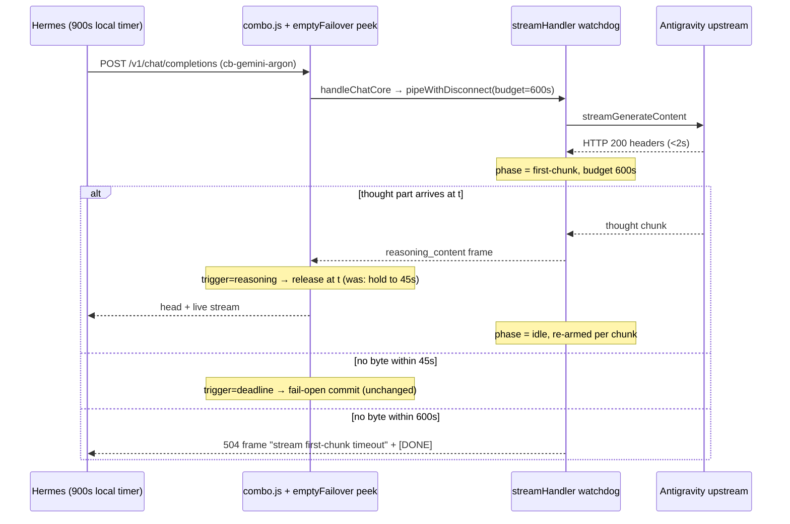

# Design: Gemini Stream Stall & Reasoning Timeout Resilience

## Context

Source of truth for findings: `explorations/2026-11-09-gemini-models-timeout-root-cause-exploration.md` (SHA-256 `a8ae5f30d3618893ed3094a9ed1db5b9c325327008d035cfe878e5655efd5e8c`, byte-identical to the canonical copy in `O:/workspaces/oss/9router/openspec/workspace/explorations/`).

Code facts verified in this worktree at HEAD `0598f9f0` (read-only):

| Fact | Location |
|------|----------|
| Peek treats only `content` / `tool_calls` / `output_text` as release signal; reasoning deliberately excluded | `open-sse/services/emptyFailover.js:26-45`, `:51-52` |
| Peek fails open at `EMPTY_PEEK_DEADLINE_MS` (45s) with `timedOut: true` | `emptyFailover.js:152-197`, `config/runtimeConfig.js:61` |
| Only caller of the peek | `open-sse/services/combo.js:21-31`, `:561-563` |
| Watchdog budget = `PROVIDERS[provider]?.stallTimeoutMs \|\| STREAM_STALL_TIMEOUT_MS` | `handlers/chatCore/streamingHandler.js:97-98` |
| Watchdog is armed at pipe start and re-armed per upstream chunk; one message `"stream stall timeout"` for both phases | `utils/streamHandler.js:195-231` |
| `transport.*` fields are copied into `PROVIDERS[id]` | `providers/index.js:12-36` |
| Existing registry precedent: `stallTimeoutMs: 120000` | `providers/registry/qoder.js:23`, `qoder-cn.js:23` |
| `STREAM_FIRST_CHUNK_TIMEOUT_MS` sole consumer is Kiro | `executors/kiro.js:12`, `:380` |
| Canonical reasoning extractor (`reasoning_content`, `reasoning`, `reasoning_details[]`) | `translator/concerns/reasoning.js:29-38` |
| Gemini/Antigravity thought parts are emitted to OpenAI clients as `reasoning_content` | `translator/response/gemini-to-openai.js:99-104` |
| No translator emits `delta.thought` | `search_files` over `open-sse/` — 0 producers |

## Goals / Non-Goals

**Goals**: remove the 9Router-induced 45s head hold when a model is actively reasoning; stop killing antigravity streams at 360s while Hermes (900s) is still waiting; make the watchdog's abort reason say which phase failed; remove the misleading `STREAM_FIRST_CHUNK_TIMEOUT_MS` comment.

**Non-Goals**: reducing Google TTFT (F1); combo hysteresis/hedging; Hermes-side timers; `FETCH_CONNECT_TIMEOUT_MS`.

## Request timeline after the change

## Decisions

### D-1 — Seam 1: add a *progress* signal to the peek; do not redefine *content*

The peek module (`emptyFailover.js`) answers one question for its caller: *commit this seat, or fall through?* Today it has one input signal (content). We add a second, independent signal (reasoning progress) **inside** the module and expose it through one new return field, `trigger: "content" | "reasoning" | "deadline" | "end" | "error"`.

- `deltaHasClientContent` keeps its meaning. Making it return `true` for reasoning (the literal brief) would also change `inspectSSELine(...).content`, which is a public export tested directly; mixing two meanings into one predicate is the shallow-module smell we are removing.
- Reasoning detection reuses `extractReasoningText` from `translator/concerns/reasoning.js` for OpenAI-shape deltas, so there is one definition of "reasoning text" in the codebase (locality). Anthropic `thinking_delta` and Responses `response.reasoning_summary_text.delta` / `response.reasoning_text.delta` become schema constants (`CLAUDE_DELTA.THINKING`, `RESPONSES_EVENT.REASONING_*`) — `open-sse/AGENTS.md` forbids hardcoded event strings.
- `delta.thought` is **not** added: no producer exists (see Context). Adding it would be a hypothetical seam. Flagged for Commander override.
- `scanSSEBuffer` state gains `sawReasoning`; `inspectSSELine` gains a `reasoning` boolean. The interface caller (`combo.js`) changes by one log string only.

**Consequence (BREAKING, needs Commander acceptance)**: once reasoning bytes are released, the seat is committed. A think-then-abort seat (reasoning, then empty stop) is delivered as-is instead of falling through. Rationale: a single client SSE response cannot splice two seats' reasoning + answer without producing a duplicated/incoherent transcript; the alternative is to keep holding reasoning, which is exactly the defect. Three tests in `tests/unit/combo-empty-failover.test.js` encode the old intent and are inverted in task 1.1 (lines 102-105 peek; 347-351 combo; and the reasoning-only assertion at line 389 inside the Responses block 387-390). The `.content === false` assertions for reasoning (lines 48, 195-196, 240-247) remain valid and are kept.

**Alternatives rejected**
| Option | Why rejected |
|--------|--------------|
| A. Treat reasoning as content in `deltaHasClientContent` | Same runtime effect but conflates two meanings in a public predicate; loses ability to log *why* a seat was committed |
| B. Shorter peek deadline (e.g. 5s) via `EMPTY_PEEK_DEADLINE_MS` | Global; also commits silent seats sooner, weakening MALFORMED_FUNCTION_CALL failover for every provider; does not distinguish progress from silence |
| C. Release on reasoning but keep a "grace window" to fall through | Bytes already reached the client; falling through would concatenate two seats — incorrect output |

**Honest limit**: when upstream emits **zero** bytes during prefill (the dominant argon pattern in the exploration's ASCII timeline), Seam 1 does not help — the 45s fail-open deadline still applies. Seam 1 removes the hold only when thought parts are streaming.

### D-2 — Seam 2: antigravity budget is registry data, not code

Add `stallTimeoutMs: 600000` to `antigravity.transport`. The resolution site already exists (`streamingHandler.js:97`) and already has two adapters (qoder, qoder-cn) — a real seam; no new code path. 600s keeps a 300s margin below Hermes's 900s local stale timer so the gateway, not the client, still owns the terminal error. Cost: a dead antigravity socket is detected after 600s instead of 360s.

`tests/__baseline__/providers-baseline.json` gains one field for `antigravity`; refreshed with the existing `node tests/__baseline__/snapshot-providers.mjs` and the diff must be exactly that one line (task 2.2).

**Rejected**: per-model budgets (only argon-high is affected but the registry has no per-model transport block — new interface for one adapter); raising global `STREAM_STALL_TIMEOUT_MS` (changes every provider's dead-socket detection).

### D-3 — Seam 3: clarify, don't wire, the first-chunk constant; label the phase

The brief offered "wire or clarify". Wiring `STREAM_FIRST_CHUNK_TIMEOUT_MS` (200s default) as a first-chunk timer on the chat path would **abort at 200s** streams that today survive to 360s and, with D-2, to 600s — it reintroduces the incident. A separate first-chunk budget per provider has no second adapter today (every provider would set it equal to its stall budget). Therefore:

1. `pipeWithDisconnect` keeps **one** budget parameter (interface unchanged — callers `streamingHandler.js` and `tests/unit/responses-abort-terminal.test.js` untouched).
2. Internally it records whether any upstream byte arrived. On fire, `abortMessage` becomes `stream first-chunk timeout` (0 bytes) or `stream stall timeout` (≥1 byte). That string already flows to `onAbortTerminal` → `buildStreamErrorBytes(504, message, sourceFormat)` and to `handleError` → `log.errorLine`. Operators can now separate prefill kills from mid-stream stalls in NUC logs without a new metric.
3. `runtimeConfig.js` comment on `STREAM_FIRST_CHUNK_TIMEOUT_MS` is corrected to "Kiro tool-call-repair only; chat streaming uses the provider stall budget". The export is kept — Kiro imports it.

Deletion test: the two-phase label is internal to `pipeWithDisconnect`; deleting it loses observability at one place only — correct depth. A `firstChunkTimeoutMs` registry field would fail the "two adapters" rule today; listed as a Commander decision, not built.

## Module/interface summary

| Module | Interface change | Hidden behaviour added |
|--------|------------------|------------------------|
| `peekStreamForContent` | return gains `trigger` | reasoning detection across 3 client formats |
| `inspectSSELine` / `scanSSEBuffer` | result/state gain `reasoning` / `sawReasoning` | — |
| `deltaHasClientContent` | none | none |
| `pipeWithDisconnect` | none | phase-labelled abort reason |
| `PROVIDERS.antigravity` | `stallTimeoutMs: 600000` | — |
| `STREAM_FIRST_CHUNK_TIMEOUT_MS` | none (comment only) | — |

## Risks / Trade-offs

| Risk | Mitigation |
|------|------------|
| Think-then-abort seats no longer fail over (D-1) | Commander acceptance gate before apply; combo log line records `trigger=reasoning` so frequency is measurable on NUC (task 4.2) |
| Dead antigravity sockets held 240s longer | Bounded at 600s < Hermes 900s; dead-socket kills were not observed in the 72h audit (all 30 kills were prefill/stall on argon) |
| Streams with TTFT > 600s still fail | Explicitly not fixed (F1). Task 4.3 measures the residual rate; Commander decides on exploration Option 1 (compaction) separately |
| Hermes 60s wait notice still appears when upstream is silent > 60s | Cosmetic liveness notice, Hermes-side (exploration §5); out of scope |
| Baseline snapshot refresh could mask unrelated provider drift | Task 2.2 requires the diff to be exactly the one antigravity line |

## Migration / Rollback

No data migration. Rollback = revert the commit and redeploy; or, without redeploy, set nothing — there is no env flag for D-1 (by design, to avoid a dead toggle). `EMPTY_PEEK_DEADLINE_MS` and `STREAM_STALL_TIMEOUT_MS` env overrides keep working unchanged.

## Ownership & gates

| IDs | Owner | Gate |
|-----|-------|------|
| 0.1 | Commander | D-1 BREAKING acceptance before any apply |
| 1.x–3.x | Coder (TDD) | Reviewer implementation review |
| 4.1 | Coder/DevOps | NUC cutover after review approval |
| 4.2–4.3 | QA | 24h NUC log window; change stays in progress until done |

## Open Questions (Commander)

1. Accept D-1 BREAKING behaviour (think-then-abort seat is committed)? Recommended: **yes**.
2. Add `delta.thought` despite having no producer? Recommended: **no**.
3. Build a per-provider `firstChunkTimeoutMs` now? Recommended: **no** (one adapter).
